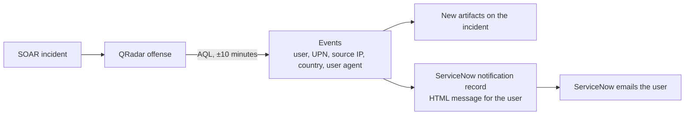

# ServiceNow SOAR Integration: Identity Alert User Notification

[](https://github.com/AtakanUk/servicenow-soar-integration/actions/workflows/ci.yml)

[](LICENSE)

When Microsoft 365 / Entra ID identity alerts reach the SOC through QRadar (atypical travel, password spray, a click on a malicious link, an MFA request reported as fraud), the fastest way to confirm or rule them out is to ask the user. This integration does that automatically from IBM QRadar SOAR:

1. reads the QRadar offense linked to the SOAR incident and runs AQL searches over its events (±10 minutes around the detection) to find who and what was involved: user name, UPN, source IP, country, user agent, etc.;
2. adds the findings to the incident as artifacts (only the new ones) and stores the user's address on the incident;
3. creates a **security notification record in ServiceNow** with an HTML message written for the end user (*why you get this mail, what to do, observation details*). A ServiceNow notification on that table emails the user, so replies and acknowledgements are tracked in the service desk instead of a shared mailbox.



## Alert profiles

| Profile | QRadar properties collected | ServiceNow short description |
| --- | --- | --- |
| `atypical_travel` | source IP, account name, UPN, country | Atypical Travel Detected |
| `password_spray` | source IP, account name, UPN, country | Password Spray Attack Detected |
| `malicious_url_click` | additional detail, user agent | Malicious Link Click Detected |
| `mfa_fraud` | additional detail, user agent | MFA Fraud Alert |

Profiles live in `user_notify/profiles.py`. Each one names the event properties to collect, the artifact types to store them as, and the message template. Adding a use case is a matter of adding a profile. When a profile does not collect the user's address itself, the incident field `SOAR_RECIPIENT_PROPERTY` is used.

## Design notes

- One AQL query per property, `GROUP BY` the value, so every distinct value comes back once.
- Searches are polled with a timeout. A stuck or failed Ariel search raises an error instead of blocking the SOAR worker thread forever.
- Artifacts are de-duplicated against the incident's existing artifacts, so re-running the function is safe.
- All values are HTML-escaped before they are put into the message; event data is attacker-controlled.
- `--dry-run` collects and renders without writing anything to SOAR or ServiceNow.

## Layout

```text
user_notify/
├── ariel.py        QRadar Ariel search client (poll + timeout)
├── enrichment.py   AQL building, value collection, artifact de-duplication
├── profiles.py     alert profiles and message templates
├── servicenow.py   ServiceNow Table API client
├── notify.py       end-to-end flow
├── config.py       clients from environment variables
└── cli.py          command line
soar_app/funct_user_notification.py   SOAR app function wrapper
```

## Usage

```bash
pip install -r requirements.txt
cp .env.example .env

python -m user_notify --incident 2101 --profile atypical_travel --dry-run
python -m user_notify --incident 2101 --profile atypical_travel
```

In SOAR, generate an app with `resilient-sdk codegen` that defines the function `user_notification` with the inputs `incident_id` and `notification_profile` (a select input with the profile names). Use `soar_app/funct_user_notification.py` as the component, and call it from the playbook of each identity-alert rule.

## Configuration

| Variable | Description |
| --- | --- |
| `QRADAR_HOST`, `QRADAR_API_TOKEN`, `QRADAR_VERIFY_SSL`, `AQL_TIMEOUT_SECONDS` | QRadar console and search timeout |
| `SERVICENOW_INSTANCE`, `SERVICENOW_USERNAME`, `SERVICENOW_PASSWORD` | ServiceNow integration user (insert rights on the table) |
| `SERVICENOW_TABLE`, `SERVICENOW_BODY_FIELD`, `SERVICENOW_RECIPIENT_FIELD` | Notification table and its message/recipient fields |
| `SOAR_*` | SOAR connection for the CLI |
| `SOAR_RECIPIENT_PROPERTY` | Incident field holding the user's address (default `qradar_user_email`) |

The QRadar property names used in the profiles (`M365 Defender UPN`, `MS365 Defender Country Letter Code`, ...) are custom event properties of the Microsoft 365 Defender DSM. Adjust them to your QRadar if they differ.

## Tests

```bash
pip install pytest
pytest
```

## License

[MIT](LICENSE)
